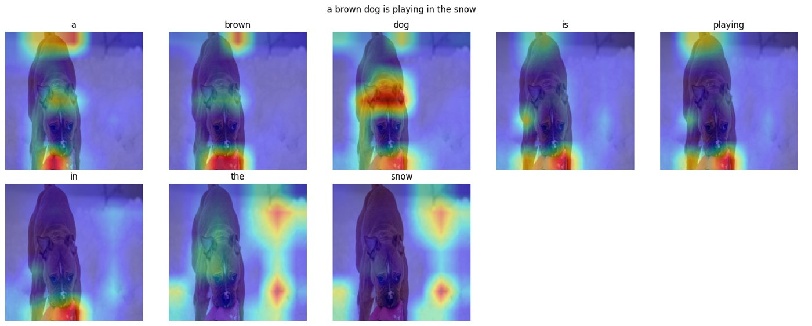
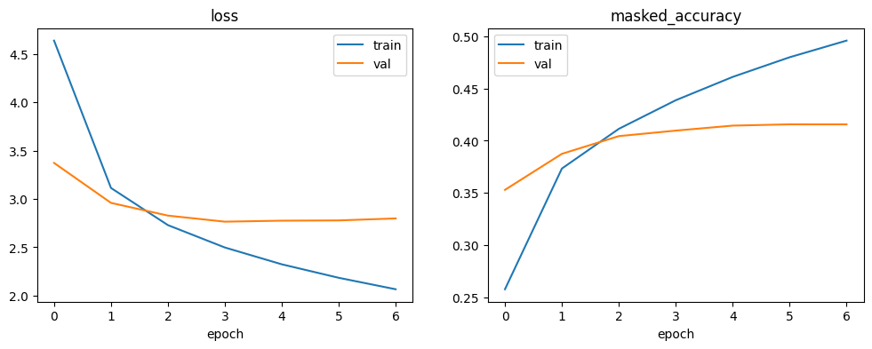
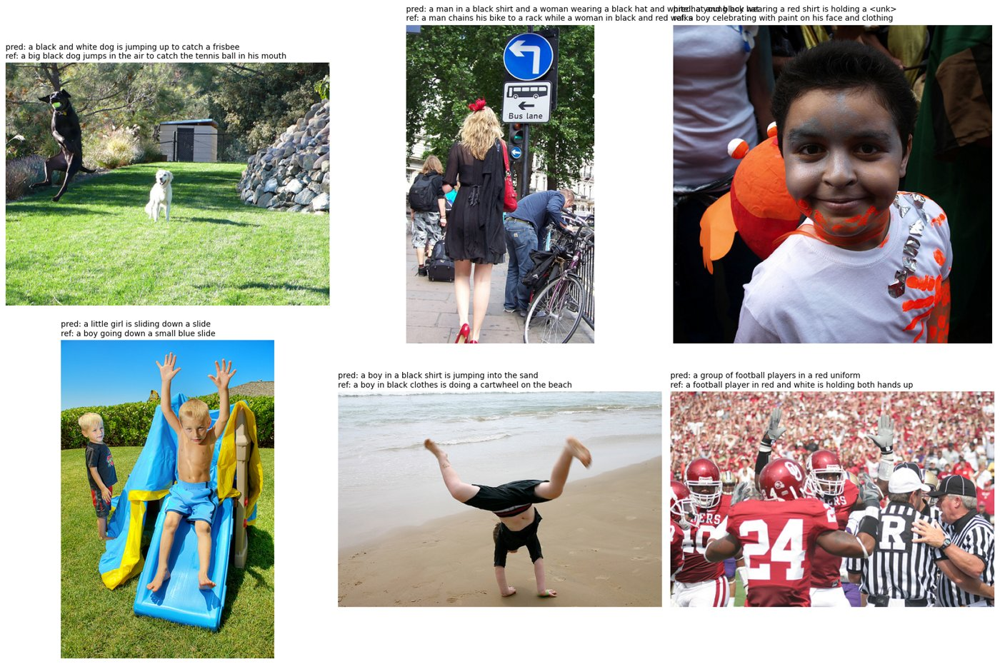

# Image Captioning with Visual Attention (Flickr8k)

An encoder-decoder image captioner in TensorFlow/Keras. The decoder attends over a 7×7 grid of image regions for every word it generates.

## Results

Held-out test set: 1,091 images, each scored against all 5 reference captions (corpus BLEU).

| Decoding | BLEU-1 | BLEU-2 | BLEU-3 | BLEU-4 |
|---|---|---|---|---|
| Greedy | 61.7 | 44.0 | 30.5 | 20.7 |
| Beam search (k=3) | **64.4** | **46.9** | **33.5** | **23.4** |

For context, Show, Attend and Tell (Xu et al., 2015) reported BLEU-4 of 19.5 (soft attention) and 21.3 (hard attention) on Flickr8k. That isn't a like-for-like comparison: they used a VGG encoder and the standard Flickr8k split, while this uses EfficientNetB0 and a seeded random split of the same sizes.

Run on Kaggle with a T4 GPU: [notebook with outputs](https://www.kaggle.com/code/adityarahul/attention-mechanism-101).

## Model

| Component | Choice |
|---|---|
| Encoder | Frozen EfficientNetB0 (ImageNet). Its 7×7×1280 map is kept as 49 region vectors, with learned 2D position embeddings |
| Decoder | 2-layer Transformer decoder (d=512, 8 heads): causal self-attention, cross-attention over the image regions, and a feed-forward block. 11.7M trainable parameters |
| Training | Teacher forcing; token-normalised masked cross-entropy; AdamW with warmup and cosine decay; early stopping on validation loss |
| Data | Vocabulary of 2,564 words (training captions only, min count 5); 6,000 / 1,000 / 1,091 images for train / val / test, split by image |
| Decoding | Greedy, and beam search (length-normalised) |

## Training

Validation loss bottoms out at epoch 4 (2.76), while training loss keeps falling. Early stopping restores the epoch-4 weights. A model this size overfits 30k captions within a few epochs. The main levers are more regularisation, a smaller decoder, or more data (Flickr30k / COCO).

## Sample captions (test images, beam search)

## Run

Open `image-captioning-attention.ipynb` on Kaggle, add the [Flickr8k dataset](https://www.kaggle.com/datasets/adityajn105/flickr8k), enable a GPU, and run all cells.

## Changes from the first version

`image-caption-generation-encoder-decoder.ipynb` was the first version: pooled Xception features with a BiLSTM decoder. A later EfficientNet variant added an attention block. Problems fixed in this rewrite:

- **The attention collapsed to rank 1.** One pooled image vector was repeated across timesteps, so every query row was identical and the model never attended to image regions. It now uses cross-attention from each word over 49 spatial regions.
- **BLEU was inflated.** `startseq` / `endseq` were scored as words. Special tokens are now stripped, and BLEU-1 to BLEU-4 are reported.
- **Caption cleaning was a no-op.** `str.replace` with a regex pattern did nothing; it's now `re.sub`. The word "a" is no longer dropped.
- **Test captions leaked into the model** through the Word2Vec embeddings. The vocabulary now comes from training captions only.
- **There was no validation split,** so the "best model" checkpoint never triggered.
- **Memory blew up** from one sample per caption prefix with one-hot targets. Training now uses one sample per caption with integer targets.

## Limitations and next steps

- The CNN is frozen. Fine-tuning its top blocks should help.
- Attention maps are the last layer averaged over heads. They're a rough view: grounding is clear for salient objects (the dog's head for "dog", the background for "snow") but noisy for small or distant objects.
- BLEU only. CIDEr and METEOR (via `pycocoevalcap`) would match the standard captioning protocol.
